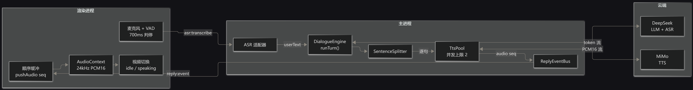
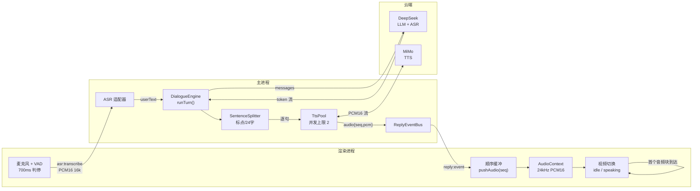
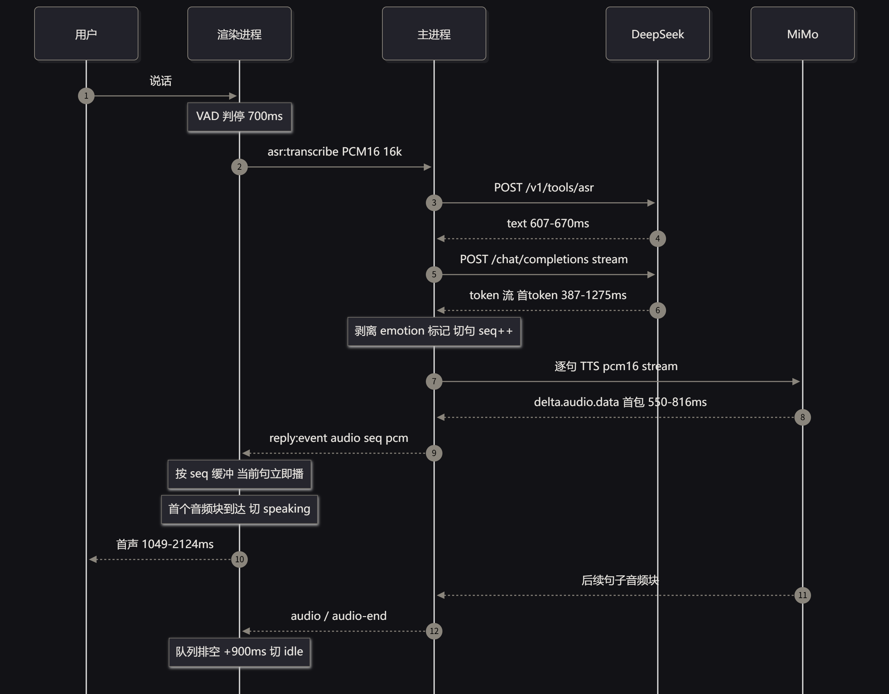
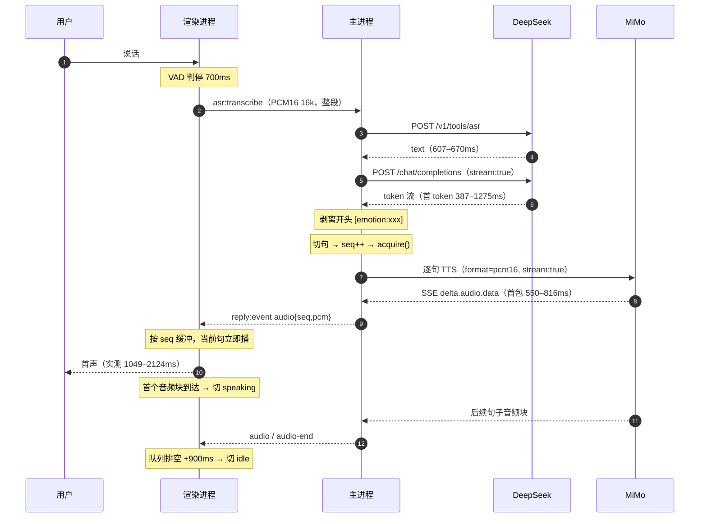
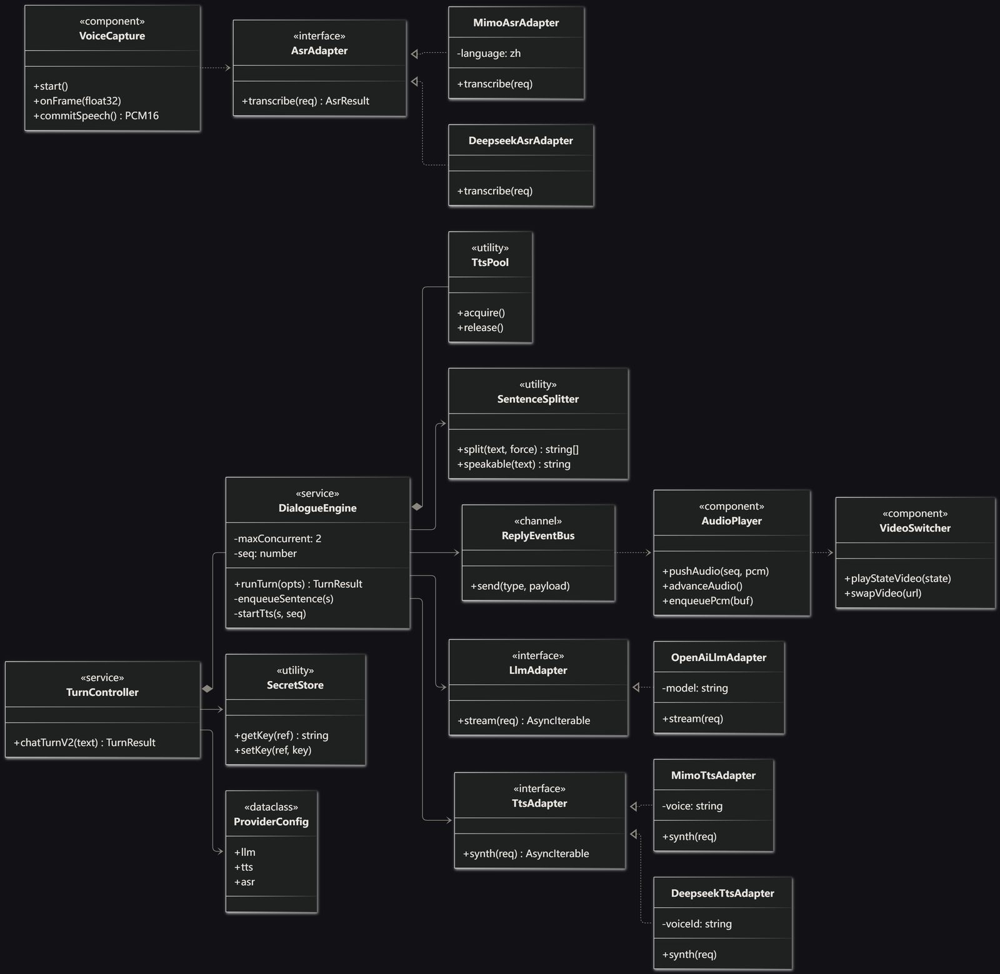
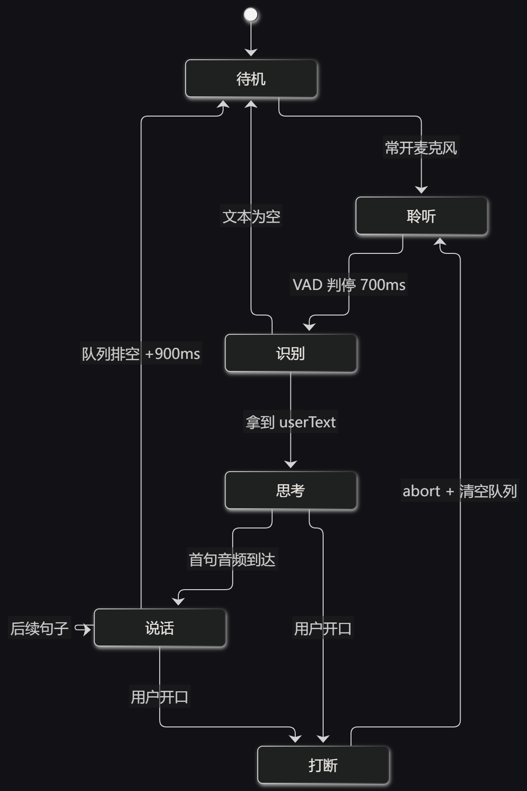
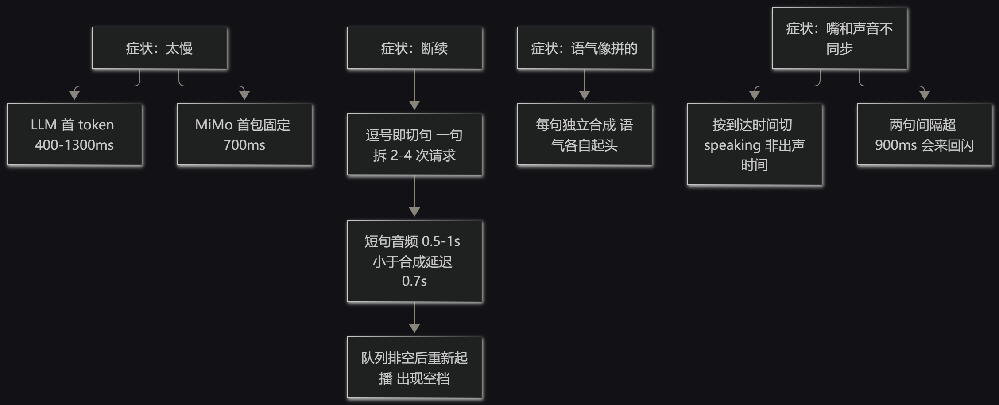
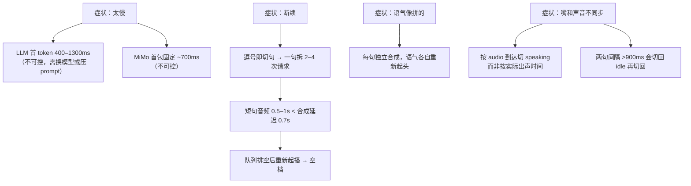

# 对话引擎 v2 · 架构图（Mermaid）

> 全部为文本定义。VS Code 预览需要装 **Markdown Preview Mermaid Support** 扩展（`bierner.markdown-mermaid`）才能渲染代码块；
> 若不想装扩展，下面每节都附了**已渲染的 PNG**，可直接查看。
>
> 重新生成图片：见 `scripts/mermaid-render/README.md`。

## 1. 数据流





## 2. 单轮时序（含实测耗时）





## 3. UML 类图



```mermaid
classDiagram
    direction LR

    class VoiceCapture {
        <<component>>
        -stream: MediaStream
        -vadThreshold: number
        +start()
        +onFrame(float32)
        +commitSpeech() PCM16
    }

    class AudioPlayer {
        <<component>>
        -ctx: AudioContext
        -nextPlayAt: number
        -playingCount: number
        +pushAudio(seq, pcm)
        +advanceAudio()
        +enqueuePcm(buf)
    }

    class VideoSwitcher {
        <<component>>
        -activeVideo: vA 或 vB
        -idleTimer: Timeout
        +playStateVideo(state)
        +swapVideo(url)
    }

    class TurnController {
        <<service>>
        -currentTurnAbort: AbortController
        -history: Message[]
        +chatTurnV2(text) TurnResult
    }

    class DialogueEngine {
        <<service>>
        -maxConcurrent: 2
        -seq: number
        -emotion: string
        +runTurn(opts) TurnResult
        -enqueueSentence(s)
        -startTts(s, seq)
    }

    class TtsPool {
        <<utility>>
        -active: number
        -waiters: Promise[]
        +acquire()
        +release()
    }

    class SentenceSplitter {
        <<utility>>
        -MARKS: string
        -maxLen: 24
        +split(text, force) string[]
        +speakable(text) string
    }

    class ReplyEventBus {
        <<channel>>
        -win: BrowserWindow
        +send(type, payload)
    }

    class LlmAdapter {
        <<interface>>
        +stream(req) AsyncIterable
    }

    class TtsAdapter {
        <<interface>>
        +caps: TtsCaps
        +synth(req) AsyncIterable
    }

    class AsrAdapter {
        <<interface>>
        +transcribe(req) AsrResult
    }

    class OpenAiLlmAdapter {
        -baseUrl: string
        -model: string
        +stream(req)
    }

    class MimoTtsAdapter {
        -voice: string
        -format: pcm16
        +synth(req)
    }

    class DeepseekTtsAdapter {
        -voiceId: string
        +synth(req)
    }

    class MimoAsrAdapter {
        -language: zh
        +transcribe(req)
    }

    class DeepseekAsrAdapter {
        -endpoint: /v1/tools/asr
        +transcribe(req)
    }

    class ProviderConfig {
        <<dataclass>>
        +llm
        +tts
        +asr
        +defaults()
    }

    class SecretStore {
        <<utility>>
        -ref: deepseek 或 mimo
        +getKey(ref) string
        +setKey(ref, key)
        +hasKey(ref) boolean
    }

    LlmAdapter <|.. OpenAiLlmAdapter
    TtsAdapter <|.. MimoTtsAdapter
    TtsAdapter <|.. DeepseekTtsAdapter
    AsrAdapter <|.. MimoAsrAdapter
    AsrAdapter <|.. DeepseekAsrAdapter

    TurnController *-- DialogueEngine
    DialogueEngine *-- TtsPool
    DialogueEngine --> SentenceSplitter
    DialogueEngine --> ReplyEventBus
    DialogueEngine --> LlmAdapter
    DialogueEngine --> TtsAdapter
    TurnController --> SecretStore
    TurnController --> ProviderConfig
    ReplyEventBus ..> AudioPlayer : reply:event
    AudioPlayer ..> VideoSwitcher
    VoiceCapture ..> AsrAdapter : asr:transcribe
```

## 4. 回合状态机

```mermaid
stateDiagram-v2
    [*] --> 待机

    待机 --> 聆听: 常开麦克风
    聆听 --> 识别: VAD 判停（700ms 静音）
    识别 --> 待机: 文本为空 / 噪声
    识别 --> 思考: 拿到 userText

    思考 --> 说话: 首句成型 → 首个音频块
    思考 --> 待机: LLM 失败（兜底台词）

    说话 --> 说话: 后续句子音频到达
    说话 --> 待机: 队列排空 +900ms

    说话 --> 打断: 用户开口（VAD 触发）
    思考 --> 打断: 用户开口
    打断 --> 聆听: abort 全部流 + 清空队列

    note right of 说话
        idle 视频 ↔ speaking 视频
        按 audio 到达切换
    end note
```





## 5. 现状标注




