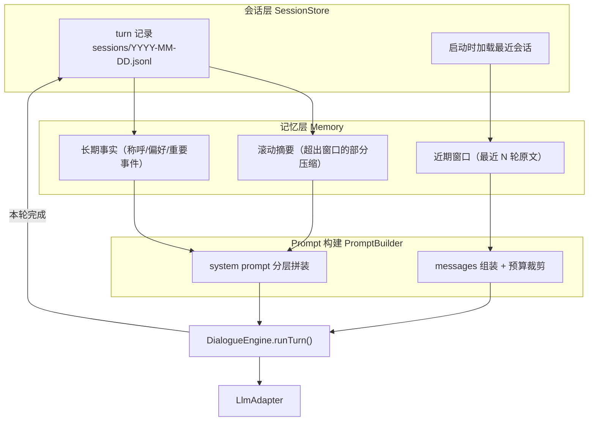

# 会话层与 Prompt 架构方案（待批准）

| 项 | 内容 |
|---|---|
| 文档 | PLAN-002-B |
| 状态 | **草案，未实施** |
| 前置 | SPEC-002、PLAN-002-A（对话质量） |
| 范围 | 会话记录、上下文管理、Prompt 分层。不含音质修复 |

---

## 1. 现状核查

| 能力 | 现状 | 证据 |
|---|---|---|
| 短期上下文 | 有，最多 12 轮 | `main.js:662` `MAX_HISTORY_TURNS = 12` |
| 上下文传递 | 有，`[...history, 本轮user]` | `engine.js:157` |
| 会话落盘 | **无** | 全项目无 `jsonl` / `conversation` / `session` 写入 |
| 超窗处理 | **直接丢弃** | `main.js:782` `history.shift()` |
| System Prompt | **硬编码常量** | `main.js:664` `PERSONA` |
| 用户自定义人设 | 无 | — |
| 长期记忆 | 无 | — |
| 对话记录可查 | 无 | — |
| Token 预算 | 无 | 只有 `max_tokens: 220` 输出限制 |

**结论**：只有"易失的、固定窗口的、硬编码 prompt 的"上下文。12 轮之前的一切对她是空白的。

---

## 2. 问题定义

| 编号 | 问题 | 后果 |
|---|---|---|
| C-1 | 记录不落盘 | 重启失忆；无法复盘的错例 |
| C-2 | 超窗即丢 | 第 13 轮之前聊过的内容永久消失 |
| C-3 | Prompt 单层 | 人设、记忆、摘要、格式约束混在一个字符串里，无法分别调 |
| C-4 | 无长期记忆 | 不会记住"你叫什么""你讨厌什么" |
| C-5 | 无 token 预算 | 轮次多了要么爆上下文，要么静默截断 |

---

## 3. 目标架构

新增**三层**，引擎只负责编排，不碰存储与拼装。




### 3.1 会话层 `SessionStore`

- 存储：`data/sessions/YYYY-MM-DD.jsonl`，追加写
- 每行一条记录：

```json
{"ts":"2026-11-21T23:10:04+08:00","turnId":"t_0007","role":"user","text":"今天有点累"}
{"ts":"...","turnId":"t_0007","role":"assistant","text":"那早点休息，别熬太晚。","emotion":"worried","firstTokenMs":412,"firstAudioMs":1080,"audioMs":2400}
```

- 关键点：**指标和文本写在同一行**，事后可直接分析"哪种回复的首声最慢"
- 启动时：加载当天文件，取最后 N 轮进内存
- 不做数据库，纯 JSONL（易读、可 grep、崩溃不坏）

### 3.2 记忆层 `Memory`

| 组成 | 内容 | 何时更新 |
|---|---|---|
| `recent` | 最近 12 轮原文 | 每轮 |
| `summary` | 更早历史的压缩摘要（≤200 字） | 超过 12 轮时，把最老 4 轮并入摘要 |
| `facts` | 结构化事实：称呼、偏好、雷区、重要日期 | 每轮后异步提取（P2） |

**摘要生成**：用同一个 LLM，一次额外调用，提示词要求"压成第三人称要点，不超过 120 字"。频率低（每 4 轮一次），成本可忽略。

### 3.3 Prompt 构建 `PromptBuilder`

**分层 system prompt**（四段，各自可开关）：

```text
【身份】你叫小夜，住在用户桌面上的陪伴角色……
【记忆】用户叫阿哲；说过最近在准备面试；不喜欢被叫"宝贝"。
【摘要】此前聊过工作压力、睡眠不好；她答应过少熬夜。
【约束】只输出口语；首句≤12字；总长≤45字；第一行 [emotion:xxx]。
```

**messages**：

```text
[system: 上面四段]
[user: 最近第1轮] [assistant: ...]
...
[user: 最近第12轮] [assistant: ...]
[user: 本轮输入]
```

### 3.4 Token 预算

| 部分 | 预算 | 超限策略 |
|---|---|---|
| system（人设+记忆+摘要） | ≤600 tokens | 先压摘要，再砍 facts 到 5 条 |
| 历史原文 | ≤1200 tokens | 从最老开始并进摘要 |
| 本轮输入 | ≤100 tokens | 超长截断并提示 |
| 输出 | ≤220 tokens | 已有 |

估算方式：中文按 1 字 ≈ 1 token 粗算，够用且零依赖。

---

## 4. 接口变化

| 模块 | 现在 | 之后 |
|---|---|---|
| `chatTurnV2` | 自己维护 history | 调 `session.append()` / `memory.recent()` |
| `engine.runTurn` | 收 `persona` + `history` | 收 `prompt: {system, messages}`，不再自己拼 |
| 新文件 | — | `electron/session.js`、`electron/memory.js`、`electron/prompt.js` |

**引擎不感知存储**，只收最终的 system + messages，这样换存储不影响引擎。

---

## 5. 分阶段

| 阶段 | 内容 | 可独立验证 |
|---|---|---|
| C0 | `SessionStore`：落盘 + 启动加载 | 重启后 `sessions/*.jsonl` 有记录，且最近 12 轮仍在上下文里 |
| C1 | `PromptBuilder`：把人设拆成四段 | 日志里能打印出完整 system prompt（脱敏） |
| C2 | `Memory.summary`：滚动摘要 | 聊 20 轮后，第 1 轮的信息仍在 system 里（以摘要形式） |
| C3 | `facts` 提取 | 说"我讨厌下雨"，10 轮后仍记得 |

C0 与 C1 可同时做；C2、C3 依赖 C0。

---

## 6. 风险

| 风险 | 影响 | 缓解 |
|---|---|---|
| 摘要调用增加延迟 | 每 4 轮多 1 次 LLM 调用 | 异步执行，不阻塞当前轮 |
| 记录含隐私 | 用户对话落盘 | 存本地、可一键清空、路径可配 |
| 上下文变长拖慢首 token | 首声变慢 | 预算上限 + 只放最近 12 轮 |
| 摘要质量差导致幻觉 | 她"记错" | 摘要只进 system，不覆盖原文；facts 需置信度 |

---

## 7. 待你决定

1. **会话边界**：按天切分？还是"每次启动继续上次"？默认建议**按天 + 继续上次最后一轮**。
2. **记录留存**：永久保留，还是只留最近 7 天？（涉及隐私与磁盘）
3. **C2/C3 是否现在做**：C0+C1 是基础，C2（摘要）和 C3（事实）可以后置。
4. **人设是否要能在界面里改**：现在是硬编码常量，要不要做成设置项？
