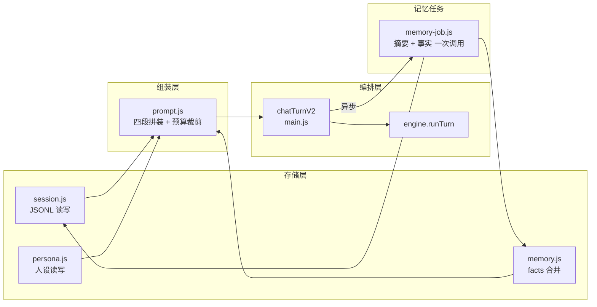
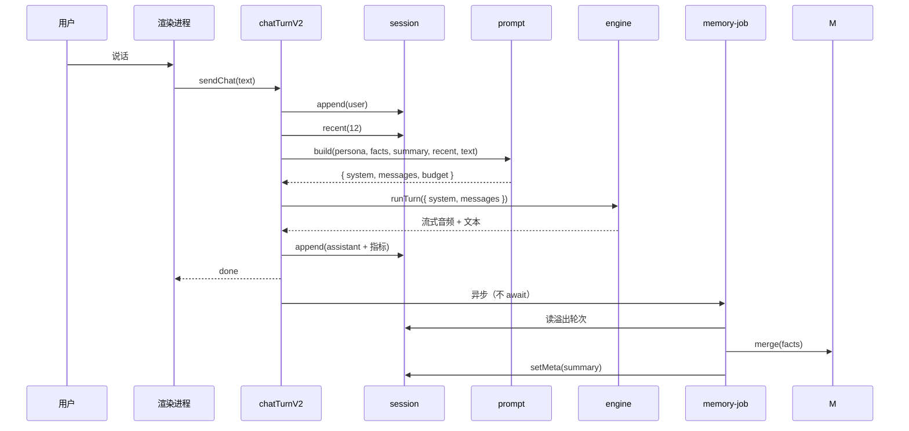

# SPEC-003 实施计划

| 项 | 内容 |
|---|---|
| 文档 | PLAN-003 |
| 对应规格 | SPEC-003 v1.0（已定稿） |
| 状态 | 待实施 |
| 分支 | `feat/mimo-v2` |

---

## 1. 架构与依赖规则



**依赖规则（硬约束）**

1. `prompt.js` **只接收数据、不读盘**——便于单测传入假数据。
2. `engine.runTurn` 只接收 `{ system, messages }`，不感知 session/memory。
3. `session/memory/persona` 之间**互不引用**。
4. 记忆任务（摘要/事实）失败**不得影响**主链路。

---

## 2. 一轮的完整时序



**关键点**：`append(assistant)` 在 `done` 之前完成（保证记录不丢），`memory-job` 在其后异步启动。

---

## 3. 关键设计

### 3.1 预算裁剪算法

```text
input: system(四段), recent(≤24条), userText
budget: system ≤600, history ≤1200 (粗算：中文 1 字 ≈ 1 token)

1) 拼 system 四段（跳过空段）
2) while est(system) > 600:
     a) 摘要 > 60 字 → 截到 60 / 40 / 20 字
     b) facts > 5   → 按 confidence 升序删到 5
     c) 仍超 → 截断 identity 到 300 字
3) while est(history) > 1200 and history.length > 2:
     删最老两条（user+assistant）
4) 组装 messages = history + user
```

**顺序不可调换**：先砍 facts 会让她忘记称呼，体验伤害最大；摘要其次；原文最后。

### 3.2 摘要与事实：一次调用两用

```text
输入：旧摘要 + 被挤出窗口的轮次（0~8 条）+ 最近 2 轮
输出（严格 JSON）：
{ "summary": "≤120字", "facts": [{ "key": "...", "value": "...", "confidence": 0.9 }] }
```

- 无溢出时 `summary` 返回 null，只更新 facts
- 解析失败 → 整次放弃，保留旧值（FR-322）
- 超时 10s 放弃（§7）

### 3.3 原子写

`memory.json` / `persona.json` / `meta.json` 均采用：

```text
写 <file>.tmp → fsync → rename 覆盖
```

避免断电产生半文件。`sessions/*.jsonl` 用追加模式，天然安全。

### 3.4 损坏容忍

- 读 JSONL：逐行 `try/catch`，坏行跳过并计数
- 读 JSON：解析失败 → 回退默认值 + 日志
- 目录缺失 → `mkdir -p`

### 3.5 记录暂停

`config.recordPaused = true` 时：

- 不写 `append`
- 不启动 `memory-job`
- 仍正常组装 prompt（用已有内存窗口）

---

## 4. 文件变更清单

| 文件 | 类型 | 说明 |
|---|---|---|
| `electron/session.js` | 新增 | JSONL 读写、清理、导出 md |
| `electron/memory.js` | 新增 | facts 合并、上限、清空 |
| `electron/persona.js` | 新增 | 人设读写与校验 |
| `electron/prompt.js` | 新增 | 四段拼装 + 预算裁剪 |
| `electron/memory-job.js` | 新增 | 摘要 + 事实一次调用 |
| `electron/engine.js` | 修改 | 改为接收 `{system, messages}` |
| `electron/main.js` | 修改 | 编排、IPC、启动清理 |
| `electron/store.js` | 修改 | 增加 `recordPaused` 默认值 |
| `electron/preload.js` | 修改 | 暴露 5 个新 IPC |
| `renderer/index.html` | 修改 | 人设编辑、记忆面板、导出按钮、暂停开关 |
| `renderer/renderer.js` | 修改 | 对应交互 |
| `tests/` | 新增 | prompt 预算、session 容错、memory 合并的单测 |

---

## 5. 阶段与提交

| 阶段 | 内容 | 独立可验证 | 提交粒度 |
|---|---|---|---|
| **S1** | `session.js`：追加、读取、按天、7 天清理 | 重启后当天上下文仍在 | 1 个提交 |
| **S2** | `persona.js` + 设置面板人设编辑 | 改人设下一轮生效 | 1 个提交 |
| **S3** | `prompt.js`：四段拼装 + 预算裁剪 | 日志里能看到完整 system | 1 个提交 |
| **S4** | `memory.js` + `memory-job.js`：摘要与事实 | 聊 20 轮后早期信息仍在 | 1 个提交 |
| **S5** | 导出 md、暂停记录、清空入口 | 导出文件格式正确 | 1 个提交 |
| **S6** | 单测 + 回归（AC-301～308） | 全部验收通过 | 1 个提交 |

每个阶段结束都：`node --check` → 重启 → 跑 2–3 轮真实对话 → 检查日志 → 提交。

---

## 6. 测试策略

| 类型 | 范围 | 方式 |
|---|---|---|
| 单元 | `prompt.build` 预算裁剪（超长摘要、facts > 5、history 超限） | Node 脚本，不依赖 Electron |
| 单元 | `memory.merge` 去重、置信度覆盖、上限淘汰 | 同上 |
| 单元 | JSONL 坏行容错 | 构造脏文件 |
| 集成 | 重启恢复、跨天切换、7 天清理 | 伪造文件 + 重启 |
| 手工 | AC-301/304/305 | 真实对话 |

---

## 7. 风险与回滚

| 风险 | 缓解 | 回滚 |
|---|---|---|
| 上下文变长导致首声变慢 | 预算上限；实测对比 AC-306 | 单独提交可 revert |
| 摘要调用偶发超时 | 10s 超时 + 保留旧摘要 | — |
| 事实误提取影响人设 | 白名单 + 置信度门槛 + 一键清空 | `memory:clear` |
| 人设被改成空内容 | 校验 + 回退默认 | `persona:reset` |
| 记录写盘失败 | 静默降级为内存模式 | — |

---

## 8. 估算

| 阶段 | 预估 |
|---|---|
| S1 | 中（读写 + 容错 + 清理） |
| S2 | 小（表单 + 落盘） |
| S3 | 中（预算算法 + 单测） |
| S4 | 大（异步任务 + 合并 + 提示词） |
| S5 | 小 |
| S6 | 中 |
